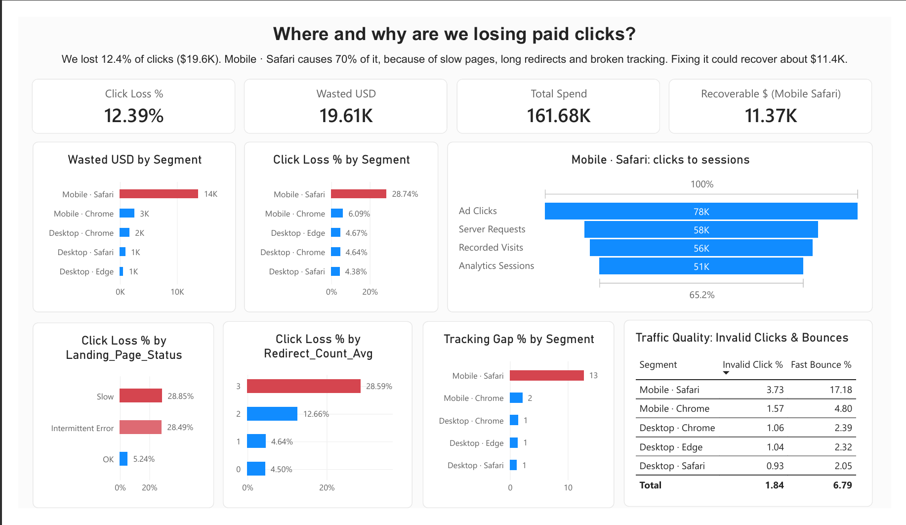

# Recovering $11K of Wasted Ad Spend: Diagnosing Click-to-Landing Loss on Mobile Safari

> SQL + Power BI analysis that finds where paid clicks disappear before reaching the landing page, why, and what fixing it is worth.

---

## Executive Summary

### Business Question
Ads are getting clicks, but fewer people show up as landing-page visits. **How big is the gap, what does it cost, and is it caused by the website, the tracking, or the clicks themselves?**

### Key Insights
| Finding | Evidence |
|---|---|
| **The gap is real and costly** | 12.4% of clicks lost (257,220 clicks → 225,350 visits), about **$19.6K wasted** out of $161.7K spend |
| **One segment causes most of it** | **Mobile · Safari** loses 28.7% of clicks vs 4–6% for every other device/browser, and accounts for **~70% ($13.8K)** of wasted spend |
| **It is not a campaign or channel problem** | Mobile · Safari loses ~29% on Facebook, Google and TikTok alike |
| **The page is failing there** | First paint of 5.9s (others 1.3–2.2s), ~15 page errors per record, 9% redirect errors; loss rises from ~5% on OK pages to ~29% on Slow / Intermittent Error pages |
| **Long redirects hurt** | Records with 3 redirect hops lose ~29% vs ~5% with 0–1 hops |
| **Tracking is also broken** | Of 78,300 Mobile · Safari clicks, ~19,800 never reached the server (real loss) and a further ~7,500 reached it but were not counted by analytics |
| **Fake clicks are not the cause** | Invalid-click rate is only 3.7% in Mobile · Safari, though fast bounces (under 2s) are 17% vs 2–5% elsewhere |

### Trade-offs & Assumptions
- **Healthy baseline = 5% loss.** To calculate the $11.4K savings, I assumed Mobile Safari can be fixed to match the ~5% loss rate of the other segments. If we only improve it partially, we will recover less money.
- **Cost = Cost per Click × (Clicks − Visits).** The "wasted spend" number only calculates the money spent on the failed ad clicks. It does not include the extra revenue we lost because those customers didn't buy anything.
- **Causes overlap.** Slow pages, redirects, and broken tracking all happen on the exact same Mobile Safari rows. Because they overlap perfectly, we can't mathematically prove which one causes the most damage. We just know all three must be fixed.
- **Averages of percentages.** For headline numbers, I used total clicks and total visits (weighted correctly). For the diagnostic charts, I averaged the percentages.
- **Sample size.** This is based on 200 sample records.; results should be re-checked as more data arrives.

### Recommendations
1. **Fix the Mobile Safari page (Web Dev Team):** Speed up the page (target first paint under 2s), and cut the redirect chain to 1 hop, removing the Tracking and Mobile redirects that break on Safari. *Expected recovery: about $11.4K.*
2. **Fix the tracking code (Data Team):** Audit the tag and fix the UTM parameters so we can accurately count visits.
3. **Monitor and protect spend  (Marketing Team): ** Add a recurring check on click-to-landing loss by device/browser, with an alert at 20%, and consider reducing Mobile · Safari bids until the fix is live.

---

## Dashboard



The Power BI report answers *where* and *why*:

- **Cards:** click loss %, wasted USD, total spend, recoverable USD
- **Where:** wasted USD and loss % by device/browser segment
- **Why (page):** loss by landing-page status and by redirect hops
- **Why (data):** Mobile · Safari funnel (clicks → server → visits → analytics sessions) and server-vs-analytics gap
- **Rule out fake clicks:** invalid-click % and fast-bounce % by segment

---

## Dataset
 
> **Note: this is a synthetic dataset.** It was generated with DeepSeek AI to simulate a paid-advertising funnel, and it does not come from a real company. The findings show the analysis method, not real business results.
 
| Item | Detail |
|---|---|
| **File** | `dataset/click_to_landing_analysis.csv` |
| **Size** | 200 rows (one row per campaign / device / browser record), 30 columns |
| **Coverage** | 3 ad channels, 9 campaigns, 5 device/browser segments (Mobile · Safari, Mobile · Chrome, Desktop · Chrome, Desktop · Edge, Desktop · Safari) |
| **Granularity** | Date, channel, campaign, device and browser |
 
**Column groups**
- **Ad performance:** impressions, clicks, CTR, cost per click, ad spend
- **Landing outcome:** recorded landing visits, click-to-landing rate, click loss rate
- **Page health:** FCP, TTI, average load time, availability, error count, landing page status
- **Redirects:** average hops, redirect error rate, redirect type
- **Tracking:** server requests, analytics sessions, tracking status, UTM status, server-vs-analytics gap
- **Click quality:** invalid click rate, bounces under 2 seconds
- **Notes:** free-text comments
**Limitations of synthetic data**
- Patterns are cleaner than real data. For example, the problems cluster in a single segment, and the relationships are close to perfect.
- Real data would be noisier, and causes would overlap less neatly.
- Results should be validated on real campaign data before any business decision.
---

## Methodology

A three-stage diagnostic, so that each question is answered before moving to the next:

**Stage 1: Measure the gap.** Compare ad clicks with recorded landing visits, compute the loss rate, and convert it to dollars. Proceed only if the gap is real (loss clearly above the normal 5–15%).

**Stage 2: Is the page at fault?** Check availability, errors, speed (FCP, TTI, load time) and redirects, then segment by device and browser to find where the loss is concentrated.

**Stage 3: Is the data at fault?** Compare server requests with analytics sessions to separate *real lost visitors* from *uncounted visitors*, check tag and UTM status, and test whether invalid clicks inflate the click count.

Findings were verified by comparing loss rates across page status and redirect-hop groups, instead of assuming that slow pages or long redirects caused the loss.

### SQL Queries

```sql
-- 1. How big is the problem, and what does it cost?
SELECT
    SUM(Ad_Clicks) AS total_clicks,
    SUM(Recorded_Landing_Visits) AS total_visits,
   ROUND(SUM(Recorded_Landing_Visits) * 100.0 / NULLIF(SUM(Ad_Clicks), 0), 2) AS Click_to_Landing_Rate_pct,
   ROUND(100.0 - (SUM(Recorded_Landing_Visits) * 100.0 / NULLIF(SUM(Ad_Clicks), 0)), 2) AS Click_Loss_Rate_pct,
   ROUND(SUM((Ad_Clicks-Recorded_Landing_Visits)*Cost_per_Click_USD),2) AS wasted_usd,
   SUM(Ad_Spend_USD) AS total_spend
FROM click_to_landing_analysis;

-- 2. Where is the loss? (channel / campaign / device+browser)
SELECT Channel, Campaign,
  SUM(Ad_Clicks) AS clicks,
  ROUND(100.0 - 100.0 * SUM(Recorded_Landing_Visits) / NULLIF(SUM(Ad_Clicks),0), 2) AS loss_pct,
  ROUND(SUM((Ad_Clicks - Recorded_Landing_Visits) * Cost_per_Click_USD), 2) AS wasted_usd,
  ROUND(100.0 * SUM((Ad_Clicks - Recorded_Landing_Visits) * Cost_per_Click_USD)
        / SUM(SUM((Ad_Clicks - Recorded_Landing_Visits) * Cost_per_Click_USD)) OVER (), 1) AS pct_of_waste
FROM click_to_landing_analysis
GROUP BY Channel, Campaign
ORDER BY wasted_usd DESC;

SELECT Device, Browser,
  SUM(Ad_Clicks) AS clicks,
  ROUND(100.0 - 100.0 * SUM(Recorded_Landing_Visits) / NULLIF(SUM(Ad_Clicks),0), 2) AS loss_pct,
  ROUND(SUM((Ad_Clicks - Recorded_Landing_Visits) * Cost_per_Click_USD), 2) AS wasted_usd,
  ROUND(100.0 * SUM((Ad_Clicks - Recorded_Landing_Visits) * Cost_per_Click_USD)
        / SUM(SUM((Ad_Clicks - Recorded_Landing_Visits) * Cost_per_Click_USD)) OVER (), 1) AS pct_of_waste
FROM click_to_landing_analysis
GROUP BY Device, Browser
ORDER BY wasted_usd DESC;

-- 3. Is it the page? (speed, errors, redirects)
SELECT
  Device,
  Browser,
  ROUND(AVG(Page_Availability_pct), 1) AS availability,
  ROUND(AVG(Avg_Page_Load_Time_seconds),1) As page_load_time,
  ROUND(AVG(FCP_seconds), 1) AS fcp,
  ROUND(AVG(TTI_seconds), 1) AS tti,
  ROUND(AVG(Page_Error_Count), 1) AS errors,
  ROUND(AVG(Redirect_Count_Avg), 1) AS redirect_hops,
  ROUND(AVG(Redirect_Error_Rate_pct), 1) AS redirect_errors,
  ROUND(100.0 - 100.0 * SUM(Recorded_Landing_Visits) / SUM(Ad_Clicks), 2) AS loss_pct 
FROM click_to_landing_analysis
GROUP BY Device, Browser
ORDER BY availability;

-- 4. Verify the correlation (don't assume it)
SELECT Landing_Page_Status, COUNT(*) AS rows_n,
  ROUND(AVG(Click_Loss_Rate_pct),2) AS avg_loss_pct
FROM click_to_landing_analysis GROUP BY Landing_Page_Status;

SELECT COALESCE(Redirect_Type,'None') AS redirect_type, Redirect_Count_Avg,
  COUNT(*) AS rows_n, ROUND(AVG(Click_Loss_Rate_pct),2) AS avg_loss_pct
FROM click_to_landing_analysis
GROUP BY 1,2 ORDER BY avg_loss_pct DESC;

-- 5. Is it the tracking? (the funnel)
SELECT
  Device,
  Browser,
  SUM(Ad_Clicks) AS clicks,
  SUM(Server_Requests) AS server,
  SUM(Analytics_Sessions) AS analytics,
  SUM(Ad_Clicks) - SUM(Server_Requests) AS never_reached_site,
  SUM(Server_Requests) - SUM(Analytics_Sessions) AS reached_but_not_counted
FROM click_to_landing_analysis
GROUP BY Device, Browser
ORDER BY never_reached_site DESC;

-- 6. Is the tracking broken?
SELECT Device, Browser, Analytics_Tracking_Status, UTM_Parameters_Status,
  COUNT(*) AS rows_n,
  ROUND(AVG(Server_vs_Analytics_Gap_pct),2) AS avg_gap
FROM click_to_landing_analysis
GROUP BY 1,2,3,4 ORDER BY avg_gap DESC;

-- 7. Are the clicks fake?
SELECT Device, Browser,
round(avg(Accidental_or_Invalid_Click_Rate_pct),2) as invalid_click_pct,
round(100.0*sum(Bounce_0_2_Sec_Count)/sum(Recorded_Landing_Visits),1) AS fast_bounce_pct
FROM click_to_landing_analysis
GROUP BY 1,2 ORDER BY invalid_click_pct DESC;

-- 8. If we fix Mobile Safari to match the healthy 5% baseline, 
-- how much wasted spend do we get back?
SELECT 
    -- Current wasted spend on Mobile Safari
    SUM((Ad_Clicks - Recorded_Landing_Visits) * Cost_per_Click_USD) AS current_waste,
    
    -- What the waste WOULD be if Mobile Safari had a healthy 5% loss rate
    SUM(Ad_Clicks * 0.05 * Cost_per_Click_USD) AS healthy_baseline_waste,
    
    -- The difference is the money you save
    SUM((Ad_Clicks - Recorded_Landing_Visits) * Cost_per_Click_USD) - SUM(Ad_Clicks * 0.05 * Cost_per_Click_USD) AS recoverable_money
FROM click_to_landing_analysis
WHERE Device = 'Mobile' AND Browser = 'Safari';

---

## Tools Used
- **SQL (PostgreSQL):** data model, aggregation and diagnostic queries
- **Power BI + DAX:** dashboard, measures and calculated columns
- **CSV dataset:** 200 campaign-day records across 3 channels, 5 device/browser segments

---

## Project Structure

```

click-to-landing-loss-analysis/
├── dataset/
│   └── click_to_landing_analysis.csv    # source dataset
├── sql/
│   └── clicks_2_visitors.sql            # sql queries
├── dashboard/
│   ├── image/
│   │   └── dashboard.png                # dashboard screenshot
│   └── power_bi_file/
│       └── clicks_to_visits.pbix        # power bi report
└── README.md

---

## Author

**Yasir Shah**
[LinkedIn](https://www.linkedin.com/in/yasir-shah-2364183b3) · [GitHub](https://github.com/yasirshah-analyst) · [Gmail](shahyasir443@gmail.com)
